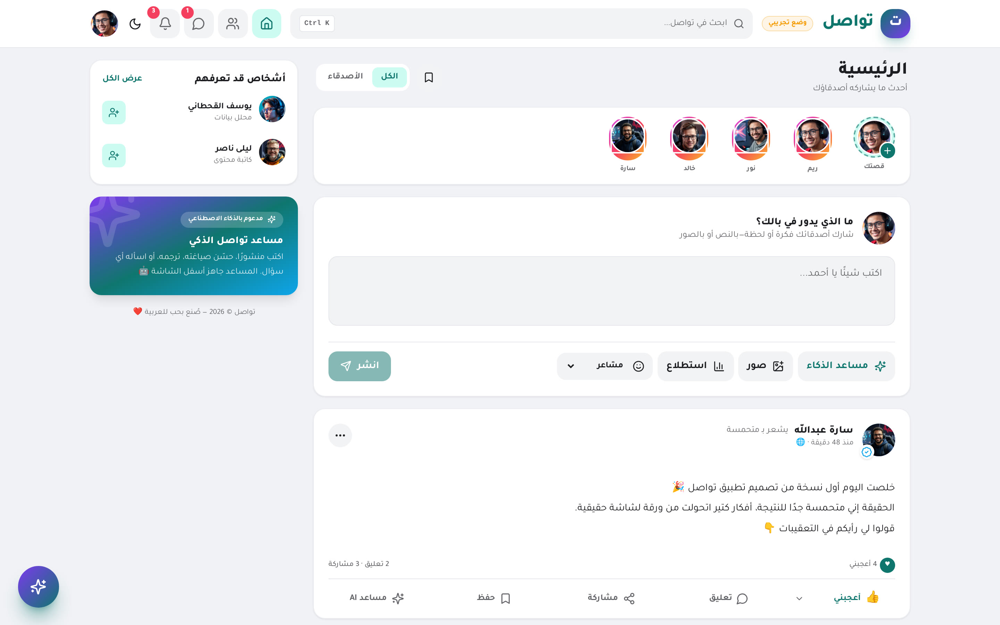
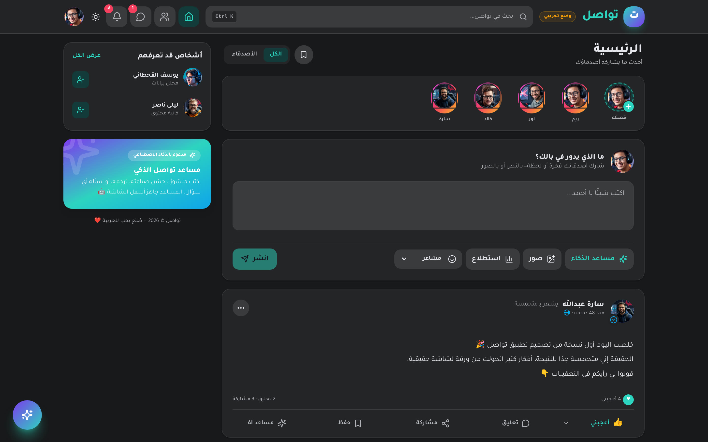
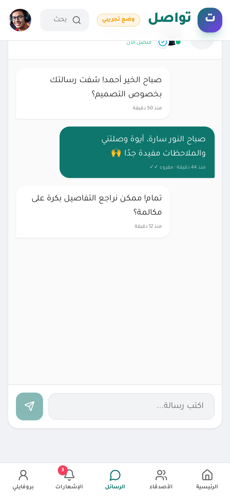

# تواصل — واجهة موقع تواصل اجتماعي

واجهة اجتماعية ثنائية اللغة (العربية RTL والإنجليزية LTR)، مبنية بـ **React + Vite + TypeScript + Tailwind CSS + React Router**.
تستخدم المصادقة وقراءة/إنشاء المنشورات API، بينما ما زالت ميزات اجتماعية أخرى تعمل ببيانات محلية تجريبية في `localStorage`.

> **تنبيه مهم:** المشروع غير جاهز بعد كمنتج متكامل. رمز جلسة API يُخزَّن في `sessionStorage` (يُمسح بإغلاق التبويب)، وبيانات المستخدم المؤقتة في `localStorage`، وبعض الميزات ما زالت محلية. لا تستخدم بيانات حقيقية قبل إعداد المصادقة والتخزين الآمنين على الخادم. أثناء الجلسة المحلية يظهر شعار «وضع تجريبي» في الشريط العلوي.

## الديمو المباشر

**https://mustafashehata744.github.io/Social-Media-App/**

حساب تجريبي جاهز: `ahmed@tawasol.com` / `123456`

## لقطات من التطبيق

<p align="center">
  
  
</p>
<p align="center">
  
  
  
</p>

## التشغيل

```bash
npm install
npm run dev        # http://localhost:5173
npm run build      # فحص TypeScript + بناء الإنتاج
npm run preview    # معاينة نسخة الإنتاج
npm run lint       # ESLint
npm test           # اختبارات الخدمات (Vitest)
```

## إعداد الـAPI

عنوان API الافتراضي هو `https://route-posts.routemisr.com`. لتغييره، عرّف `VITE_API_BASE_URL` في ملف `.env.local`:

```env
VITE_API_BASE_URL=https://your-api.example.com
```

المصادقة تستدعي `POST /users/signin` و`POST /users/signup`، ويُتوقع أن يعيد الخادم رمز دخول وبيانات المستخدم. المنشورات تستدعي `GET /posts/feed` و`POST /posts`.

## الحسابات التجريبية

| البريد | كلمة المرور |
| --- | --- |
| `ahmed@tawasol.com` | `123456` |
| `sara@tawasol.com` | `123456` |

هذه الحسابات جزء من البيانات المحلية التجريبية، ولا تعمل لتسجيل الدخول عبر API إلا إذا كانت موجودة على الخادم. في صفحة الدخول يوجد زر لكل حساب تجريبي يسجّل الدخول المحلي مباشرة، وتظهر معه علامة «وضع تجريبي» أعلى التطبيق.

## الصفحات

| المسار | الوصف | محمي؟ |
| --- | --- | --- |
| `/` | صفحة هبوط للزائر | لا |
| `/register` | إنشاء حساب مع تحقق من الحقول | لا |
| `/login` | تسجيل دخول مع رسائل أخطاء | لا |
| `/feed` | منشورات، تفاعلات Like/Love/Care، تعديل وإخفاء المنشورات، إدارة التعليقات، قصص الأصدقاء، ورفع الصور | نعم |
| `/profile/:id` | بروفايل المستخدم ومنشوراته بصورة شخصية وغلاف | نعم |
| `/profile/edit` | تعديل الاسم، النبذة، رفع الصورة الشخصية وصورة الغلاف | نعم |
| `/friends` | طلبات، قبول/رفض، اقتراحات، إزالة | نعم |
| `/messages` | محادثات فورية تجريبية | نعم |
| `/notifications` | إشعارات مع تحديد كمقروء | نعم |
| `/settings` | اللغة، المظهر، خلفية التطبيق، إشعارات، خصوصية، خروج، وإعادة البيانات | نعم |

## هيكل المجلدات

```
src/
├── components/
│   ├── ai/          مساعد الشات العائم
│   ├── layout/      الهيدر، الشريط الجانبي، تنقل الموبايل
│   ├── posts/       المنشور، التعليقات، التفاعلات، عارض الصور، كاتب المنشور
│   ├── stories/     إنشاء قصص الأصدقاء وعرضها
│   └── ui/          مكونات مشتركة (Avatar, Modal, ImagePicker, Spinner...)
├── context/         Auth / Language / Theme / Toast
├── data/seed.ts     البيانات التجريبية جاهزة الاستخدام
├── hooks/           useDataVersion, useClickOutside, useFocusTrap
├── lib/             storage + lang + image (ضغط الصور) + backgrounds + utilities
├── pages/           كل صفحة في ملف مستقل
├── routes/          ProtectedRoute / PublicRoute
├── services/        طبقة البيانات + طبقة AI
└── types/           الأنواع المشتركة
```

## طبقة البيانات — حالة الربط الحالية

طبقة API موجودة في `src/lib/api.ts`، والمكوّنات تتعامل مع الخدمات في `src/services/`.

```ts
// نقاط API المستخدمة حاليًا
POST /users/signin
POST /users/signup
GET  /posts/feed
POST /posts
```

بقية عمليات المنشورات (التعديل، الحذف، التفاعلات والتعليقات والمشاركة) وملفات `users.service.ts`, `messages.service.ts`, `stories.service.ts`, `notifications.service.ts`, `settings.service.ts` ما زالت محلية. يلزم ربطها بـAPI وتحديد عقود الطلبات والاستجابات قبل استخدامها كبيانات مشتركة بين المستخدمين.

حدود معروفة في الوضع الحالي:

- **الاستطلاعات** محلية فقط؛ تُخفى من كاتب المنشور أثناء جلسة API لأن عقد `POST /posts` لا يدعمها بعد.
- **الرسائل** محلية بالكامل، وعلامات التسليم والقراءة (✓✓) محاكاة بمؤقت وليست إشعارات حقيقية بين مستخدمين.
- **التفاعلات والتعليقات** على منشورات الـAPI تُحفظ محليًا على الجهاز ولا تصل للخادم.

المفاتيح المحلية تبدأ بـ `tawasol:*`. عند أي تعديل، يُطلق حدث `tawasol:changed` (انظر `lib/storage.ts`) لتتحدث الواجهة تلقائيًا عبر `useDataVersion`.

> كلمة المرور في الحسابات التجريبية موجودة للعرض فقط. لا تُخزّن كلمات مرور المستخدمين في الواجهة؛ إدارة الجلسات الآمنة مسؤولية الخادم.

## مساعد AI الحقيقي

النسخة المنشورة تستخدم Cloudflare Workers Free وWorkers AI مع نموذج Gemma 4 للترجمة وتحسين وكتابة المنشورات واقتراح المشاريع. الطلبات تُرسل إلى Cloudflare لمعالجتها. لا ترسل بيانات حساسة. يوجد حد مجاني يومي مشترك؛ عند نفاده تظهر رسالة خطأ، ولا يوجد بديل مدفوع تلقائي.

- إعداد الواجهة في `src/services/ai.ts` و`src/services/turnstile.ts`.
- إعداد الخادم في `server/cloudflare/wrangler.jsonc` و`worker.mjs`.
- تحقق Turnstile منفصل لكل طلب مع فحص الخادم للرمز واسم الموقع والإجراء.
- حد 5 طلبات لكل دقيقة لكل IP، وحدود لطول النص والطلب والإجابة، ونموذج ثابت.
- مفتاح Turnstile السري محفوظ في إعدادات Worker فقط، وليس في المستودع أو الواجهة.
- مفاتيح `VITE_*` المنشورة هي الرابط ومفتاح الموقع العام فقط.

لإعادة النشر بإذن صاحب الحساب:

```sh
npx wrangler deploy -c server/cloudflare/wrangler.jsonc
npx wrangler secret put TURNSTILE_SECRET -c server/cloudflare/wrangler.jsonc
```

يجب استخدام Widget إنتاجي مسموح له باسم موقع الواجهة. لا تستخدم مفاتيح الاختبار في الإنتاج. لا تفعل الخطة المدفوعة أو تضف بطاقة دون إذن. إذا تعطلت الخدمة تُعرض رسالة واضحة، ولا يُستبدل الرد الحقيقي برد مزيف. النسخ غير المعدّة تعرض علامة صريحة على الردود التجريبية.
